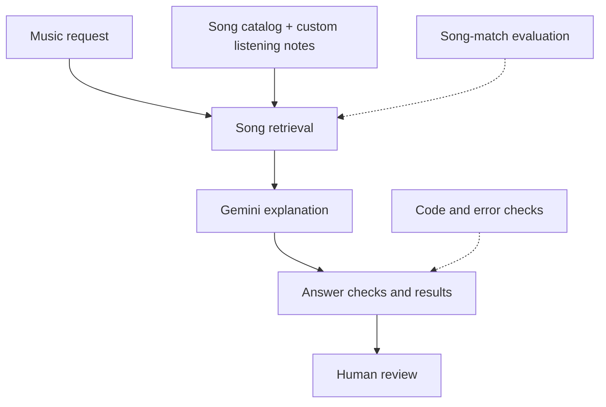

# Music Recommender with RAG

This command-line recommender accepts everyday-language music requests and
returns three catalog matches with AI-generated explanations grounded in song data.

## Original project

I extended [Music Recommender Simulation](https://github.com/Bhabishya-Poudel/ai110-module3show-musicrecommendersimulation-starter)
from **CodePath Module 3, Week 6**. The original project matched a listener's genre,
mood, energy, and acoustic preferences to a local song catalog. It used weighted
scores to return ranked songs with reasons.

## Architecture

MiniLM embeddings and metadata checks find songs using the catalog and custom
listening notes. Gemini explains the selected records, then the app validates
the answer's format and song IDs.



More detail: [system diagram](diagrams/system.md).

## Setup

1. **Environment:** Python 3.13, with commands executed from the project root
   containing `requirements.txt`:

   ```bash
   python3 -m venv .venv
   source .venv/bin/activate
   python -m pip install -r requirements.txt
   ```

   Windows PowerShell activation: `.venv\Scripts\Activate.ps1`.

2. **Credentials:** a local `.env` file based on `.env.example`, containing a
   [Gemini API key](https://aistudio.google.com/apikey). Existing `.env` values
   can be retained:

   ```dotenv
   GEMINI_API_KEY=PASTE_API_KEY_HERE
   GEMINI_MODEL=gemini-3.5-flash-lite
   ```

3. **Execution:** the following command starts the interactive prompt; `quit`
   ends the session:

   ```bash
   python -m src.main
   ```

Tested on macOS arm64 with Python 3.13.15. First run downloads model weights;
Gemini needs internet access and available quota. Code changes take effect after
restarting the app. The `--demo` option runs the original recommender.

## Sample interactions

Command used for the three recorded examples:

```bash
printf 'calm songs\nenergetic rock for a workout\njazz music\nquit\n' | python -m src.main
```

Recorded output excerpts follow. Each request returns three songs;
these excerpts show the first recommendation. Gemini wording can vary.

**1. Calm music**

```text
Input: calm songs
Output excerpt:
1. Spacewalk Thoughts by Orbit Bloom (ID: 6, match score: 0.911)
- Spacewalk Thoughts by Orbit Bloom (ID: 6): Spacewalk Thoughts by Orbit Bloom fits the calm request as it is an ambient song with a chill mood and calm mood tags. [Sources: data/songs.csv]
```

**2. Workout music**

```text
Input: energetic rock for a workout
Output excerpt:
1. Storm Runner by Voltline (ID: 3, match score: 0.878)
- Storm Runner by Voltline (ID: 3): Storm Runner by Voltline fits the request as an intense rock song with aggressive, driving, and powerful mood tags and a high energy of 0.91. [Sources: data/songs.csv]
```

**3. Jazz**

```text
Input: jazz music
Output excerpt:
1. Coffee Shop Stories by Slow Stereo (ID: 7, match score: 0.856)
- Coffee Shop Stories by Slow Stereo (ID: 7): Coffee Shop Stories by Slow Stereo fits the request as it is explicitly a jazz song with a relaxed mood, cozy warm and nostalgic tags, and high acousticness. [Sources: data/songs.csv]
```

[Full command, inputs, and all outputs](evidence/sample_interactions.txt).
For jazz, the app also flagged two poor matches: the catalog has only one jazz song.

## RAG enhancement: custom documents

The app also reads [custom listening notes](data/listening_notes.md), an
AI-assisted Markdown document linking three songs to suggested activities.
Each note is joined to its song before embedding; selected notes are included
in Gemini's prompt. Displayed explanations identify their source files.

For `music for a pomodoro session revising lecture notes`, an actual retrieval
comparison produced:

| Sources searched | First result |
|---|---|
| Song catalog only | Moonlit Sonata Redux (ID: 12); Focus Flow was outside the top three |
| Catalog + custom notes | Focus Flow (ID: 9), whose note suggests Pomodoro sessions and reviewing lecture notes |

Gemini's live response attributed the suggestion to the notes: "Editorial
listening notes suggest it as a background choice for a Pomodoro session or
revising lecture notes..."

The extra source supplies activity context absent from the CSV. The
catalog-only baseline uses `SongRAG(use_notes=False)`. The notes are editorial,
not evidence of improved concentration. This example demonstrates
the added context; it does not establish broad improvement.

## Design decisions

- **Hybrid retrieval:** embeddings support flexible wording; hand-weighted
  metadata checks help enforce explicit preferences.
- **Local catalog and reused index:** easy to inspect and fast after startup,
  but limited in variety.
- **Guardrails:** validate inputs and citations; keep matches visible if Gemini
  fails. Citation checks cannot verify every generated claim.

`logs/rag.log` excludes request text and keys. Requests and selected records go
to Google. Git ignores `.env`, logs, and generated reports.

## Testing summary

```bash
python -m pytest -q            # Automated tests; no API calls
python -m src.main --evaluate  # Compare retrieval methods; no Gemini calls
```

**53 out of 53 automated tests passed.** These use fake embeddings and mocked
Gemini responses to check code behavior without API calls. Representative checks:

| Test case | Expected behavior | Result |
|---|---|---|
| `calm songs` with misleading embedding scores | Return low-energy songs; exclude Gym Hero from the top three | Pass |
| Empty or overlong request | Reject before calling the embedding model | Pass |
| Missing API key | Keep local matches and explain that a key is needed | Pass |
| Generated song ID `999` | Withhold the invalid explanation | Pass |
| Simulated Gemini quota error | Show a safe message; keep retrieved matches available | Pass |
| API error containing a secret | Exclude the secret and request text from application logs | Pass |
| Custom listening notes | Change retrieval, reach Gemini, and display source files | Pass |

**Actual-model evaluation:** on eight labeled requests, hybrid retrieval placed
a relevant song first **8/8 times**, versus **7/8** for embeddings alone. Across
all returned songs, **11/24** were labeled relevant, versus **10/24** before.
The remaining weak matches show the limits of the tiny catalog and always
returning three songs. Full results: `reports/retrieval-evaluation.json`.

**Lesson:** embedding-only retrieval initially put Gym Hero above calmer songs;
mood and energy checks fixed that regression. Passing code tests does not prove
recommendation accuracy or explanation factuality.


## Reproducible execution evidence

These executions use the project root and an activated virtual environment.
Shell examples use macOS/Linux syntax. The linked text
files contain actual commands, inputs, exit codes, and captured stdout;
model-loading diagnostics on stderr are omitted. Timings, local paths, and
Gemini wording may vary.

**1. Live RAG run** — requires a valid Gemini key:

```bash
printf 'music for a pomodoro session revising lecture notes\nquit\n' | python -m src.main
```

Actual output excerpt:

```text
1. Focus Flow by LoRoom (ID: 9, match score: 0.376)
- Focus Flow by LoRoom (ID: 9): Focus Flow by LoRoom is suggested for a Pomodoro session revising lecture notes due to its focused and calm tags, energy of 0.40, and instrumentalness of 0.88. [Sources: data/songs.csv, data/listening_notes.md]
```

[Full input/output transcript](evidence/sample_run.txt).

**2. Guardrails** — blank input followed by a request with the key temporarily
set to empty. This does not edit `.env` or call Gemini:

```bash
printf '\ncalm songs\nquit\n' | GEMINI_API_KEY='' python -m src.main
```

Actual output excerpts:

```text
What kind of song are you looking for? Please enter a music request, such as 'calm music for studying'.
1. Spacewalk Thoughts by Orbit Bloom (ID: 6, match score: 0.911)
Set GEMINI_API_KEY in .env to generate explanations.
What kind of song are you looking for? Goodbye!
```

[Full guardrail transcript](evidence/guardrails.txt). Both checks completed
without crashing; local retrieval remained available without a key.

**3. Automated tests and retrieval evaluation** — no Gemini calls:

```bash
python -m pytest -q
python -m src.main --evaluate
```

Actual output excerpts:

```text
53 passed in 6.17s

Hand-labeled requests: 8
Strategy      Precision@3   Recall@3    Hit@3    MRR@3
metadata            0.375      0.646    0.875    0.750
embedding           0.417      0.771    1.000    0.938
hybrid              0.458      0.792    1.000    1.000
```

Full results: [automated test log](evidence/tests.txt) and
[retrieval evaluation log](evidence/evaluation.txt). These establish tested code
behavior and performance on the small labeled set, not universal AI accuracy.
