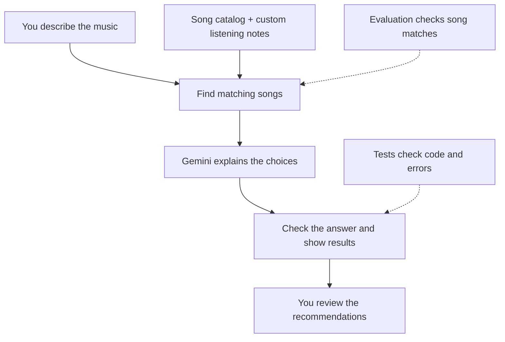

# How the system works

- **Find songs:** compare the request with the catalog using embeddings and
  mood, genre, and energy preferences. Custom listening notes enrich the indexed
  song descriptions.
- **Explain and check:** send the request and three selected records to Gemini;
  include their custom notes and validate the answer's format and cited song
  IDs before showing explanations with source filenames.
  Retrieved songs remain visible if generation fails.
- **Automated checks:** `pytest` checks code behavior; `--evaluate` compares
  retrieval results with manually labeled song IDs.
- **Human review:** check whether recommendations fit and explanations agree
  with the catalog. This is a manual review, not an approval step in the app.
