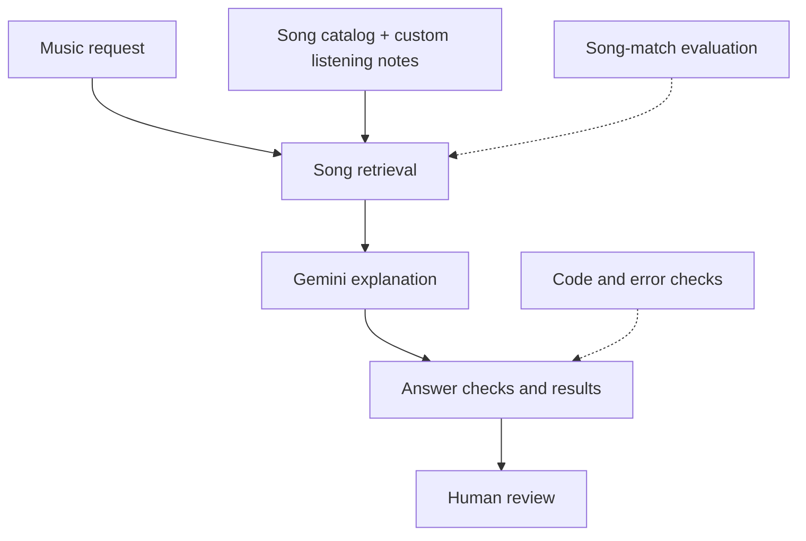

# How the system works

- **Song retrieval:** the request is compared with the catalog using embeddings and
  mood, genre, and energy preferences. Custom listening notes enrich the indexed
  song descriptions.
- **Explanation and validation:** Gemini receives the request, three selected
  records, and their custom notes. Answer format and cited song IDs are checked
  before explanations appear with source filenames.
  Retrieved songs remain visible if generation fails.
- **Automated checks:** `pytest` checks code behavior; `--evaluate` compares
  retrieval results with manually labeled song IDs.
- **Human review:** relevance and agreement with the catalog can be assessed
  manually. The app does not include an approval step.
